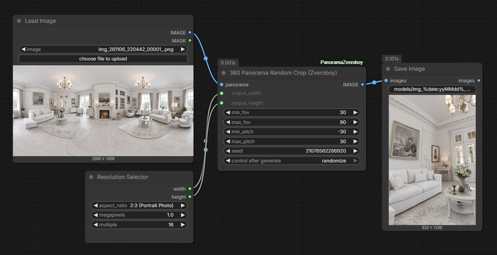
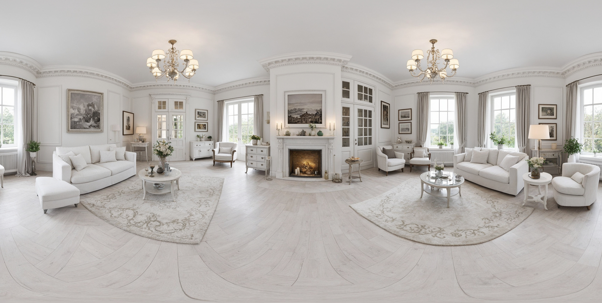
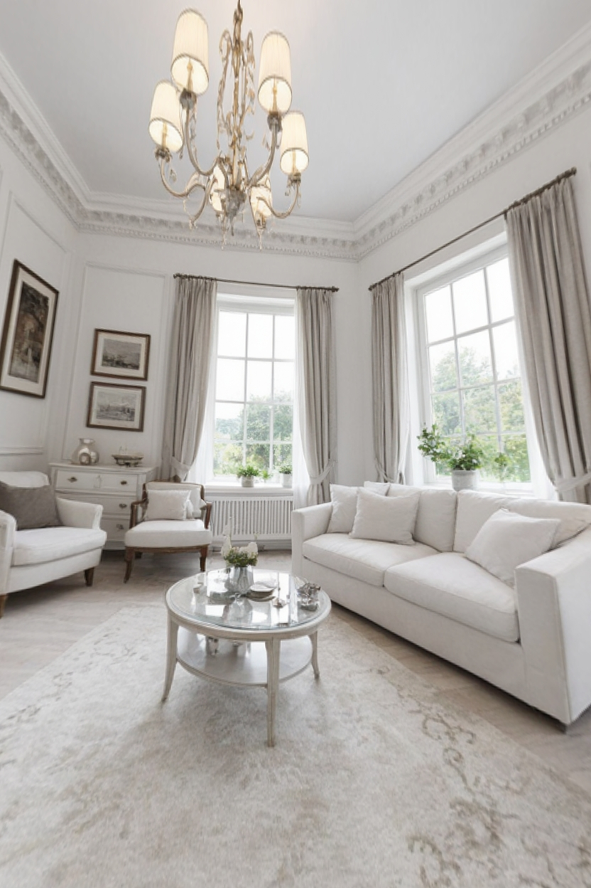
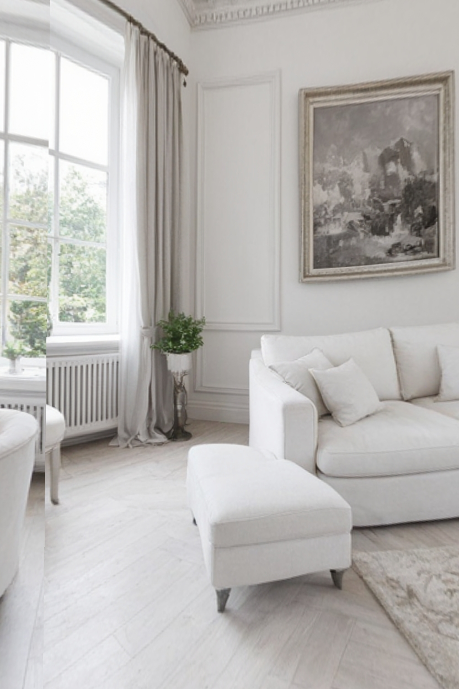
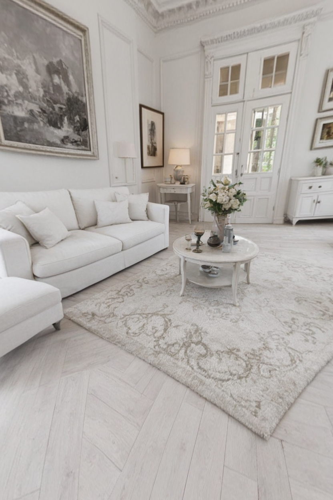
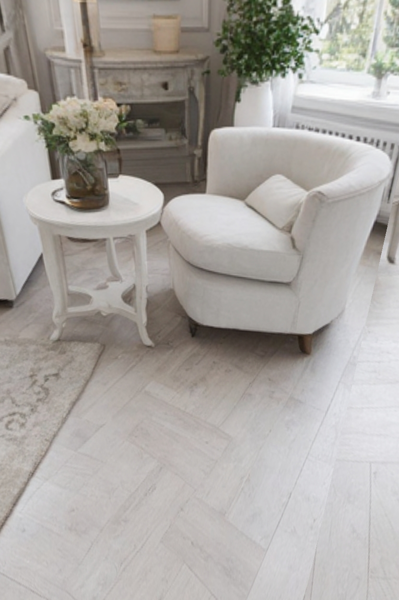
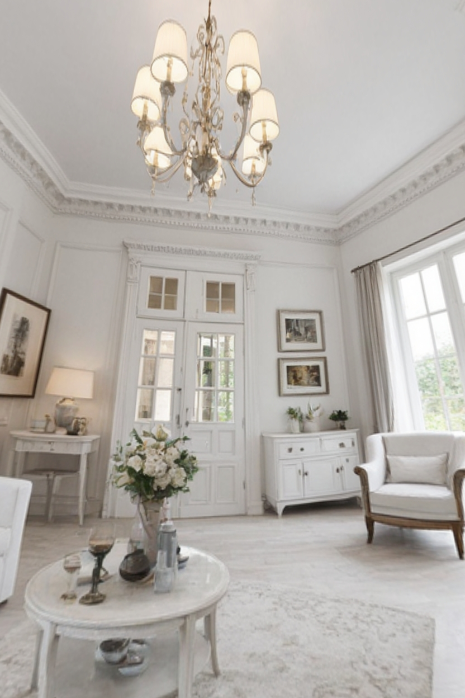
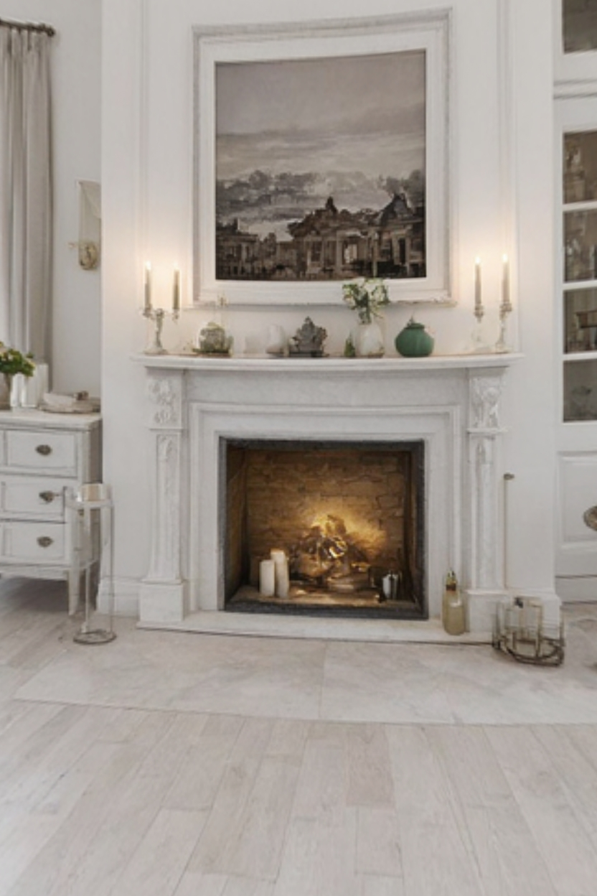
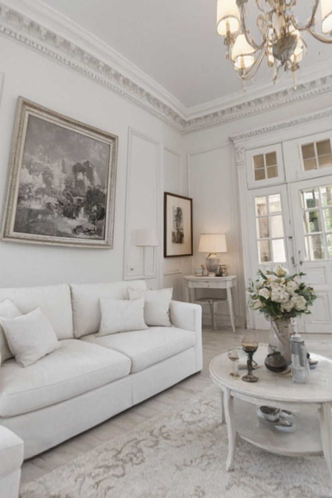

# ComfyUI-PanoramaZveroboy

Кастомный узел для ComfyUI, реализующий динамическое кадрирование 360-градусных эквидистантных панорам в плоские перспективные изображения с рандомизацией точки взгляда и фокусного расстояния.

Я разработал эту ноду для решения практической задачи в своём рабочем процессе: подготовка разнообразных ракурсов из единого 360-ассета для генерации видео и создания консистентных локаций для съёмок фэшн-моделей.

---

## Демонстрация

### Воркфлоу

Минимальный воркфлоу: **Load Image** → **360 Panorama Random Crop (Zveroboy)** → **Save Image**.
Разрешение выхода задаётся любым удобным нодом (на скриншоте — `Resolution Selector`, 2:3 Portrait, 1.0 MP, multiple 16).

### Исходная панорама

Один 360-ассет в эквидистантной проекции (2000×1008, соотношение 2:1) — источник всех кадров ниже.

### Результаты работы ноды

Все кадры получены из одной панорамы выше при `min_fov = 30`, `max_fov = 90`, `min_pitch = -30`, `max_pitch = 30` и случайном `seed`:

<table>
  <tr>
    <td align="center"> result1</td>
    <td align="center"> result2</td>
    <td align="center"> result3</td>
    <td align="center"> result4</td>
  </tr>
  <tr>
    <td align="center"> result5</td>
    <td align="center"> result6</td>
    <td align="center"> result7</td>
    <td></td>
  </tr>
</table>

Каждый запуск даёт новый ракурс: меняются азимут (yaw), наклон камеры (pitch) и угол обзора (FOV). При фиксированном `seed` результат полностью воспроизводим.

---

## Теоретико-методологические аспекты

В основе ноды лежит строгий математический аппарат преобразования координат. Я использую **обратное проектирование (backward mapping)**: для каждого пикселя выходного изображения вычисляется соответствующий луч в сцене, что критически важно для сохранения качества и отсутствия артефактов при интерполяции.

### 1. Эквидистантная цилиндрическая проекция (Equirectangular)

Исходная панорама представляет собой сферическую проекцию, развёрнутую в прямоугольник с соотношением сторон 2:1. Координатная сетка определяется двумя углами:

- **Азимут** θ ∈ [−π, π] — горизонтальное поле (yaw);
- **Угол места** φ ∈ [−π/2, π/2] — вертикальное поле (pitch).

Переход от сферических координат к UV-координатам панорамы:

    u = θ / (2π) + 0.5
    v = 0.5 − φ / π

### 2. Модель камеры-обскуры (Pinhole Camera)

Для каждого пикселя выходного изображения я вычисляю 3D-вектор луча, проходящего через фокусное расстояние f, которое напрямую зависит от заданного угла обзора (FOV):

    f = W_out / (2 · tan(FOV / 2))

где W_out — ширина выходного изображения в пикселях.

### 3. Матрицы поворота

Случайные углы **Yaw** (рыскание вокруг оси Y) и **Pitch** (тангаж вокруг оси X) конвертируются в матрицы вращения:

    R_x = | 1    0       0    |
          | 0  cos φ  −sin φ  |
          | 0  sin φ   cos φ  |

    R_y = |  cos θ   0   sin θ |
          |    0     1     0   |
          | −sin θ   0   cos θ |

Итоговая матрица поворота: **R = R_y · R_x**.

### 4. Сферическая интерполяция и Grid Sample

Мировые векторы переводятся обратно в сферические координаты, а затем в UV-координаты исходной панорамы. Для сэмплирования я использую нативную PyTorch-функцию `F.grid_sample`, что обеспечивает высокую скорость работы на GPU и корректную билинейную интерполяцию. Ключевой момент — математический `wrap-around` по горизонтали (`u = u % 1.0`), который устраняет чёрные швы на стыке краёв панорамы.

---

## Установка

1. Перейдите в директорию `custom_nodes` вашего ComfyUI:

        cd ComfyUI/custom_nodes

2. Клонируйте репозиторий:

        git clone https://github.com/thezveroboy/ComfyUI-PanoramaZveroboy.git

3. Перезапустите ComfyUI. Нода появится в категории **Zveroboy/Panorama** под именем **360 Panorama Random Crop (Zveroboy)**.

Дополнительные зависимости не требуются — нода использует только `torch` и `numpy`, которые уже входят в окружение ComfyUI.

---

## Использование

### Входные параметры

| Параметр | Тип | По умолчанию | Диапазон | Описание |
|---|---|---|---|---|
| `panorama` | IMAGE | — | — | Входное 360-изображение в эквидистантной проекции (обычно 2:1) |
| `output_width` | INT | 1024 | 64–8192 | Ширина выходного плоского изображения |
| `output_height` | INT | 1024 | 64–8192 | Высота выходного плоского изображения |
| `min_fov` | FLOAT | 45.0 | 10–120 | Минимальный угол обзора (широкоугольный объектив) |
| `max_fov` | FLOAT | 90.0 | 10–120 | Максимальный угол обзора (телеобъектив) |
| `min_pitch` | FLOAT | −30.0 | −90–90 | Минимальный вертикальный наклон камеры |
| `max_pitch` | FLOAT | 30.0 | −90–90 | Максимальный вертикальный наклон камеры |
| `seed` | INT | 0 | 0–2⁶⁴−1 | Сид для воспроизводимости рандома |

### Выходы

| Выход | Тип | Описание |
|---|---|---|
| `IMAGE` | IMAGE | Плоское перспективное изображение заданного размера |

---

## Практические сценарии применения

При генерации серий снимков часто требуется консистентность локации: нужна та же комната, та же улица, тот же парк или тот же водопад. Сейчас это особенно важно для видеогенерации — в модель в качестве референса передают отдельное изображение с локацией, но такой кадр показывает место только с одной стороны. Панорама позволяет увидеть локацию со всех ракурсов, однако в исходном виде она искажает картинку и не подходит на роль референса напрямую.

Кроме того, стартовые изображения обычно готовятся заранее, и панораму туда уже не вставить — кадр нужно вырезать. Ракурсы приходится выставлять вручную: в графическом редакторе или отдельными нодами кадрирования, подбирая положение камеры и масштаб.

Нода упрощает этот рутинный этап. На вход подаётся готовое панорамное изображение, на выходе — случайный ракурс внутри локации строго нужного размера и формата. Настройки угла зрения (FOV) задают тип плана — от крупных портретных кадров до широких панорам, а диапазон `pitch` регулирует, насколько камера может задираться вверх или наклоняться вниз: динамичные ракурсы для активных сцен или спокойное повествование.

Можно запустить серию генераций и через пару минут отобрать подходящие ракурсы, отбросив неудачные. По ощущениям это как отправить деятельного, но не слишком понятливого ассистента заменить вас в рутинной задаче подготовки предварительных ракурсов для видео.

---

## Технические особенности

- **Оптимизация для GPU:** все вычисления сетки пикселей и матричные умножения выполняются в тензорах PyTorch, что обеспечивает высокую скорость работы даже при разрешении выхода 2K и 4K.
- **Поддержка батчей:** нода корректно обрабатывает батчи изображений, применяя независимую рандомизацию для каждого кадра.
- **Отсутствие артефактов:** благодаря корректному маппингу UV и использованию `padding_mode='border'`, на выходе не возникает чёрных дыр или разрывов текстуры.
- **Корректный wrap-around:** горизонтальная склейка краёв панорамы реализована через модулярную арифметику, а не через дублирование пикселей, что сохраняет точность интерполяции.

---

## Лицензия

MIT. Свободное использование и модификация с указанием авторства.
